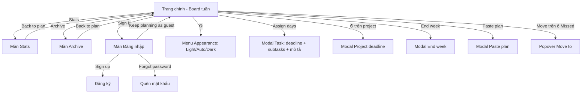

# Phân tích & đặc tả: Ứng dụng Weekly Planner (tham khảo old.beaverplans.com)

> Tài liệu được lập từ việc thao tác thực tế trên trang (chế độ Guest) ngày 21/10/2026.
> Mục đích: làm bản đặc tả để tự xây một ứng dụng **tương tự về chức năng**. Nên đặt tên, logo và nhận diện riêng, không sao chép thương hiệu "planner." / beaverplans.

---

## 1. Tổng quan sản phẩm

- **Loại**: Single Page App, lập kế hoạch theo **tuần** cho sinh viên/người học.
- **Ý tưởng cốt lõi**: `Project` (môn học) → `Task` (việc) → gán vào **các ngày trong tuần** → mỗi ngày là một **subtask** (checkbox riêng). Tuần tự "lấp đầy" từ việc gán ngày.
- **Hai chế độ lưu**: Guest (lưu `localStorage`) và Signed-in (đồng bộ qua backend).
- **Phong cách**: tối giản, "giấy" (paper), font serif + mono, màu đất nung.

### Tech stack quan sát được

| Thành phần | Quan sát |
|---|---|
| Frontend | React SPA build bằng **Vite** (`/assets/index-[hash].js`, mount `#root`) |
| Backend/Auth | **Supabase** (auth email + password, đồng bộ dữ liệu) |
| Lưu Guest | `localStorage` (key state dạng JSON + `planner.theme`) |
| Hosting | **Vercel** (+ Vercel Analytics, Speed Insights) |
| Font | Fraunces / Newsreader (serif, tiêu đề & nội dung), JetBrains Mono (nhãn, nút) |
| PWA | có `theme-color`, `apple-mobile-web-app-capable` |

---

## 2. Sơ đồ màn hình & luồng



---

## 3. Bố cục trang chính

```
┌──────────────────────────────────────────────────────────────┐
│ planner.                    📅 PLANNING FOR [‹ Oct 19–25 ›] [↩]│  ← header
│        [♥ SUPPORT] ⚙ GUEST · SAVED LOCALLY [SIGN IN][STATS][ARCHIVE]
│ ████████░░░░░░░░░░░░░░░░░░░░   1/3 · 33%   [END WEEK ↺]      │  ← progress tuần
├──────────────────────────────────────────────────────────────┤
│ THIS WEEK                                                    │
│ Focusing Wed (today) · show all days                         │
│ [MON !◦][TUE][WED ◦][THU][FRI][SAT][SUN]   ← dải 7 ngày      │
│ ┌ WED ─────────────────────────── 0/1 · 0% ┐  ← ngày focus   │
│ │ ☐ TEST PROJECT / Read chapter 3  2/2     │                 │
│ └──────────────────────────────────────────┘                 │
├──────────────────────────────────────────────────────────────┤
│ PROJECTS                         [COPY PLAN] [PASTE PLAN]    │
│ ┌ ⠿ Test Project            ▬▬░░ 1/3     ⏱  × ┐             │
│ │ ⠿ ☐ Read chapter 3         [1/2]   ASSIGN DAYS → 📅 ×     │
│ │ + add task                                    │             │
│ └───────────────────────────────────────────────┘             │
│ [            + ADD PROJECT (viền nét đứt)          ]          │
└──────────────────────────────────────────────────────────────┘
```

---

## 4. Luồng chi tiết (đã kiểm tra)

### 4.1 Onboarding (board rỗng)
- Lời chào theo giờ: "Good afternoon. Let's plan your week."
- Thẻ hướng dẫn 3 bước có số thứ tự: **1 Make a project → 2 Add a task → 3 Give it some days**, kèm mini demo (checkbox "read chapter 3 0/1", nút MON/**WED**/FRI).
- CTA đổi theo tiến độ: `+ ADD YOUR FIRST PROJECT` → `+ ADD A TASK` → `PICK DAYS FOR A TASK`. Bước xong hiện ✓ xanh.
- Khi task đầu tiên có ngày, thẻ onboarding biến mất, thay bằng dải 7 ngày.

### 4.2 Tạo Project
- Bấm CTA hoặc `+ ADD PROJECT` → thẻ project mới với input tiêu đề lớn (serif) "Project name..." được focus sẵn.
- Gõ tên → lưu tự động (không có nút Save).
- Thẻ project: tay nắm kéo ⠿ (sắp xếp), thanh tiến độ mini + `done/total`, nút ⏱ (deadline project), nút × (xoá — **không hỏi xác nhận**).

### 4.3 Tạo Task
- `+ add task` → input inline. **Enter** lưu và tự mở dòng task trống tiếp theo (nhập liên tục); **Esc** để thoát.
- Task chưa có ngày hiện nhãn đỏ `ASSIGN DAYS →` và icon lịch.
- ⚠️ Quan sát: dòng task trống vẫn được lưu và tính vào tổng (`0/3` thay vì `0/2`). Khi tự làm nên **bỏ qua task có title rỗng** khi blur.

### 4.4 Modal "Assign days" (chỉnh Task)
- Header: tên project (nhãn nhỏ) + tên task.
- **Deadline**: date + time (tuỳ chọn), dòng trạng thái "No deadline set."
- **Subtasks**: 7 nút toggle Mon…Sun. Mỗi ngày bật → tạo 1 subtask cho ngày đó, có:
  - ô note (optional), nút ×, `+ add subtask` (nhiều subtask trong cùng 1 ngày),
  - kéo ⠿ để sắp xếp hoặc chuyển sang ngày khác.
- Gợi ý: "No subtasks yet, so it won't show in the week."
- **Description (optional)**: ghi chú chung cho task.
- Nút `Cancel` / `Save`.
- Sau khi lưu, task hiển thị badge `done/total` (vd `0/2`) màu xanh.

### 4.5 Board tuần
- **Chế độ Focus** (mặc định = hôm nay): dải 7 ngày, ngày focus viền màu accent; bên dưới là danh sách subtask của ngày đó, góc phải `done/total · %`.
- Ký hiệu trên ô ngày: `◦` có việc, `!` có việc **bị lỡ** (ngày đã qua mà chưa xong).
- **Show all days**: lưới 4 cột (Mon–Thu / Fri–Sun), mỗi ô là card ngày có `done/total · %`; ngày trống hiện "–". Link `focus today` để quay lại.
- Click checkbox subtask → gạch ngang, nền xanh nhạt, cập nhật mọi bộ đếm (ngày, task, project, tuần).
- **Subtask bị lỡ**: card nền đỏ nhạt, chữ `MISSED`, nút `MOVE` → popover:
  - "Move to": các ngày còn lại (ngày đã qua bị disable),
  - checkbox "Count Mon as missed" (ghi nhận lịch sử lỡ),
  - Cancel.

### 4.6 Điều hướng tuần
- `‹ Oct 19 – Oct 25 ›` + nhãn `THIS WEEK` / `NEXT WEEK`.
- Sang tuần khác: hiện nút ↩ để quay về tuần hiện tại. Board dùng chung dữ liệu, chỉ đổi mốc tuần (dùng để lên kế hoạch trước).

### 4.7 End week
Modal: "This snapshots the week into your archive. What should happen to tasks that aren't finished yet?"
- `Carry unfinished forward` (giữ việc chưa xong sang tuần mới)
- `Clear everything` (nút đỏ, xoá sạch)
- `Cancel`
→ Tạo bản ghi trong **Archive** và dữ liệu cho **Stats**.

### 4.8 Copy / Paste plan
- `COPY PLAN` → copy kế hoạch vào clipboard, banner xanh "Plan copied. Use 'Paste plan' on any board to drop it in." (có Dismiss, tự ẩn), nút đổi thành `COPIED ✓`.
- `PASTE PLAN` → modal: textarea "Paste here with Cmd/Ctrl+V…", checkbox **Reset checkmarks (start fresh)**, `Add to board` → thêm dưới các project hiện có.
- Dùng để tái sử dụng kế hoạch từ tuần archive hoặc chia sẻ giữa người dùng.

### 4.9 Stats & Archive
- Trang riêng, header rút gọn + `‹ BACK TO PLAN`.
- Trạng thái rỗng: "No stats yet. End a week to start tracking…" / "No archived weeks yet. Hit 'End week'…"
- CSS có biến `--heat-1..3` → Stats nhiều khả năng có **heatmap** mức hoàn thành.

### 4.10 Settings, Auth, Support
- ⚙ → popover **Appearance**: Light / Auto / Dark (lưu `planner.theme`).
- Nhãn trạng thái: `GUEST · SAVED LOCALLY`.
- Sign in: màn full, card giữa: Email, Password (nút hiện/ẩn 👁), Forgot password?, Sign in, "No account? Sign up", "‹ Keep planning as a guest".
- Support: link ngoài tới trang donate.

---

## 5. Mô hình dữ liệu (suy ra từ state Guest)

```json
{
  "tasks": [                     // thực chất là danh sách Project
    {
      "id": "g6rnwvc",
      "title": "Test Project",
      "deadline": null,
      "subs": [                  // Task trong project
        {
          "id": "6qp3pzb",
          "title": "Read chapter 3",
          "done": false,
          "deadline": null,
          "desc": "",
          "slots": [             // Subtask theo ngày
            { "day": "mon", "done": false, "missed": [], "desc": "pages 1-20" },
            { "day": "wed", "done": true,  "missed": [] }
          ]
        }
      ]
    }
  ],
  "archives": [],                // snapshot các tuần đã End week
  "weekStart": null              // mốc tuần đang lập kế hoạch
}
```

Gợi ý đặt tên rõ hơn khi tự làm: `projects[] → tasks[] → slots[]`. ID ngắn 7 ký tự ngẫu nhiên (`Math.random().toString(36).slice(2,9)`).

### Schema Supabase gợi ý (cho user đăng nhập)

```sql
create table plans (
  user_id uuid primary key references auth.users on delete cascade,
  state jsonb not null,          -- cùng cấu trúc JSON ở trên
  updated_at timestamptz default now()
);
alter table plans enable row level security;
create policy "own plan" on plans for all
  using (auth.uid() = user_id) with check (auth.uid() = user_id);
```
Cách đơn giản nhất: lưu cả state dạng JSONB một dòng/user (giống bản Guest), debounce ghi ~500ms. Khi đăng nhập lần đầu: merge state localStorage lên server.

---

## 6. Quy tắc tính toán

| Chỉ số | Công thức |
|---|---|
| Tiến độ tuần | số slot `done` / tổng slot của tất cả task (hiện `x/y · %`) |
| Tiến độ project | tổng slot done / tổng slot trong project |
| Badge task | slot done / số slot |
| Tiến độ ngày | slot done của ngày / tổng slot của ngày |
| Missed | `day < hôm nay` (trong tuần hiện tại) và `done == false` |
| Task done | tất cả slot done (hoặc tick checkbox task) |

---

## 7. Design tokens

| Token | Light | Dark |
|---|---|---|
| `--bg` | `#f4f1ea` | `#1a1815` |
| `--paper` (card) | `#fbfaf6` | `#231f1b` |
| `--ink` | `#1c1a17` | `#ece7dd` |
| `--ink-soft` | `#56514a` | `#b3ab9e` |
| `--ink-faint` | `#928b80` | `#847d70` |
| `--line` | `#e2ddd2` | `#332f29` |
| `--line-strong` | `#d2ccbe` | `#463f37` |
| `--accent` | `#b5482e` | `#d46a4e` |
| `--accent-soft` | `#e9d9d2` | `#3a2a23` |
| `--good` | `#4f7a4a` | `#7ba874` |
| `--good-soft` | `#dde7da` | `#2a3626` |
| `--heat-1/2/3` | `#e7c8bc / #d89e85 / #c66f4e` | `#432c22 / #77432d / #a85a3c` |
| `--r` (radius) | `10px` | |
| `--shadow` | `0 1px 2px rgba(28,26,23,.04), 0 8px 24px -12px rgba(28,26,23,.12)` | |

- Nền có hoạ tiết chấm mờ (`--dot`), theme qua `[data-theme="dark"]`.
- Typography: tiêu đề serif (Fraunces), body serif (Newsreader), nhãn/nút **UPPERCASE mono** (JetBrains Mono, letter-spacing rộng).
- Nút chính: nền accent, chữ trắng; nút phụ: viền mảnh, nền `--control-bg`.

---

## 8. Cấu trúc component React đề xuất

```
src/
├─ App.tsx                 // router: plan | stats | archive | auth
├─ store/usePlanner.ts     // state + actions (Zustand hoặc useReducer), persist localStorage/Supabase
├─ lib/week.ts             // tính weekStart, ngày hôm nay, missed
├─ components/
│  ├─ Header.tsx           // logo, WeekPicker, nav buttons, ThemeMenu
│  ├─ WeekProgress.tsx
│  ├─ Onboarding.tsx       // 3 bước + CTA động
│  ├─ DayStrip.tsx         // 7 ô ngày (focus mode)
│  ├─ DayPanel.tsx         // danh sách slot của 1 ngày
│  ├─ WeekGrid.tsx         // show all days
│  ├─ SlotCard.tsx         // checkbox, MISSED, MoveMenu
│  ├─ ProjectCard.tsx      // tiêu đề inline, progress, deadline, delete
│  ├─ TaskRow.tsx          // inline edit, badge, ASSIGN DAYS
│  └─ modals/ TaskModal, ProjectDeadlineModal, EndWeekModal, PastePlanModal
└─ pages/ Stats.tsx, Archive.tsx, Auth.tsx
```
Kéo-thả: `@dnd-kit/core` + `@dnd-kit/sortable`.

---

## 9. Lộ trình làm (MVP → đầy đủ)

1. **MVP Guest**: Project/Task/Slot CRUD, modal Assign days, Focus day + Show all days, tiến độ, localStorage.
2. Missed + Move, deadline task/project, điều hướng tuần.
3. End week (carry / clear) → Archive; Copy/Paste plan (JSON hoặc text).
4. Stats (tỉ lệ hoàn thành theo tuần, heatmap theo ngày).
5. Supabase Auth + đồng bộ, merge dữ liệu guest khi đăng nhập.
6. Theme Light/Auto/Dark, PWA, deploy Vercel.

## 10. Điểm có thể làm tốt hơn bản gốc

- Xác nhận (hoặc Undo toast) khi xoá project.
- Không lưu task có tiêu đề rỗng.
- Hỗ trợ phím tắt (N = new task, ←/→ đổi ngày focus).
- Xuất/nhập file JSON backup cho chế độ Guest.
